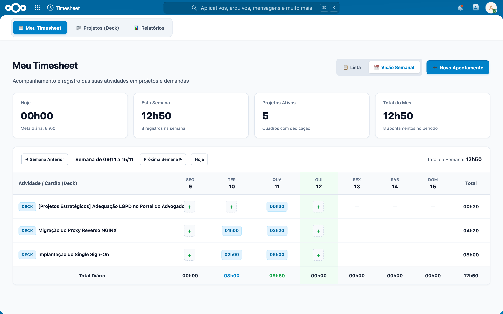
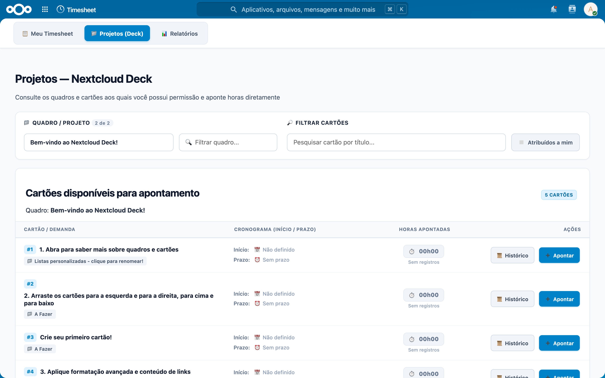
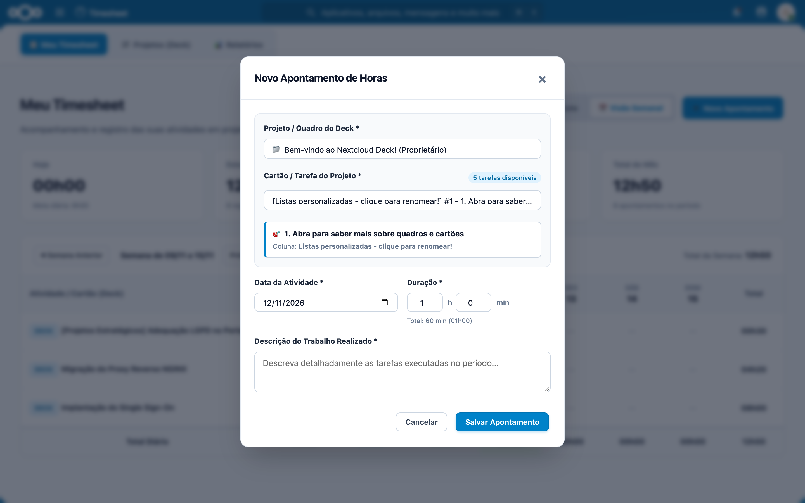
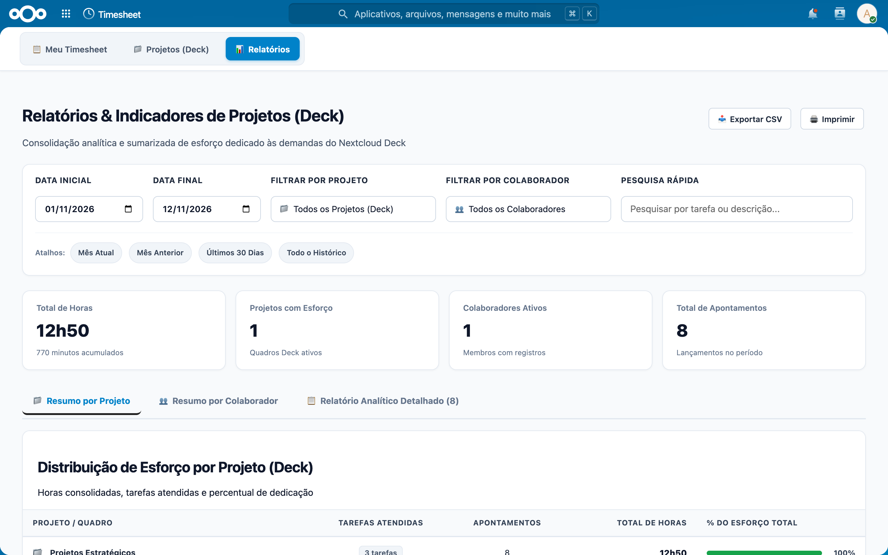

# Timesheet — Apontamento de Horas Integrado ao Nextcloud Deck

[](https://apps.nextcloud.com/apps/oab_timesheet)
[](https://apps.nextcloud.com/apps/oab_timesheet)
[](https://www.php.net/)
[](LICENSE)

Aplicação moderna e intuitiva para apontamento, gestão e auditoria de esforço profissional totalmente integrada aos quadros e cartões do **Nextcloud Deck**.

**Autor:** [Igor Pita](https://github.com/igorpita)  
**ID do Aplicativo:** `oab_timesheet`  
**Página Oficial na Loja:** [apps.nextcloud.com/apps/oab_timesheet](https://apps.nextcloud.com/apps/oab_timesheet)

---

## 📸 Demonstração Visual

### 1. Meu Timesheet — Grade Semanal e Indicadores
Acompanhe seus lançamentos diários com visão semanal completa, totalizadores de horas por dia, status de aprovação e cartões de resumo de esforço.


### 2. Projetos e Demandas do Deck
Navegue diretamente pelos seus quadros e cartões do Nextcloud Deck. Filtre por projetos específicos ou ative a opção **"Atribuídos a mim"** para encontrar rapidamente as tarefas sob sua responsabilidade.


### 3. Registro Ágil de Horas (Modal de Apontamento)
Lance horas de forma rápida e precisa selecionando data, tarefa de destino, duração e descrição detalhada da atividade realizada.


### 4. Relatórios Analíticos e Auditoria Gerencial
Filtre lançamentos por período, colaborador ou projeto. Visualize totais consolidados e exporte a grade completa para planilhas em formato **CSV**.


---

## ✨ Principais Recursos

- **Integração Nativa com o Nextcloud Deck:** Consulta e vincula horas diretamente aos cartões e quadros existentes, sem duplicar tarefas.
- **Autenticação Unificada (Single Sign-On):** Utiliza a própria sessão do usuário no Nextcloud, sem necessidade de logins ou senhas adicionais.
- **Grade Semanal Interativa:** Navegação intuitiva entre semanas com somatório diário e indicação visual do progresso.
- **Controle de Acesso e Permissões:** Colaboradores acompanham seus próprios lançamentos; gestores e donos de quadros têm visão ampla dos projetos sob sua liderança.
- **Trilha de Auditoria Completa:** Registro transparente de alterações e histórico para conformidade e governança.
- **Exportação de Dados:** Exportação de relatórios em CSV para faturamento, prestação de contas ou folha de ponto.
- **BI / Metabase Ready:** Acompanha scripts de views SQL para integração direta com dashboards no Metabase ou ferramentas de BI.

---

## 💻 Requisitos do Sistema

- **Nextcloud:** 28.x até 36.x
- **PHP:** 8.1 até 8.5
- **Banco de Dados:** PostgreSQL, MariaDB ou MySQL
- **Dependência:** Aplicativo **Deck** habilitado no Nextcloud

---

## 📦 Como Instalar

### Método 1: Pela Loja de Aplicativos do Nextcloud (Recomendado)
1. Acesse seu Nextcloud como Administrador.
2. Abra o menu superior e clique em **Aplicativos** (ou *Apps*).
3. Na categoria **Organização** ou utilizando a barra de busca, pesquise por **Timesheet**.
4. Clique em **Baixar e ativar**.

### Método 2: Instalação Manual
1. Baixe o pacote mais recente `oab_timesheet.tar.gz` na página de [Releases](https://github.com/igorpita/timesheet/releases).
2. Extraia o conteúdo no diretório de aplicativos do seu Nextcloud (ex: `/var/www/html/custom_apps/` ou `apps/`):
   ```bash
   tar -xzf oab_timesheet.tar.gz -C /var/www/html/custom_apps/
   chown -R www-data:www-data /var/www/html/custom_apps/oab_timesheet
   ```
3. Habilite o aplicativo via terminal com o comando `occ`:
   ```bash
   sudo -u www-data php /var/www/html/occ app:enable oab_timesheet
   ```

---

## 🛠️ Como Usar

1. **Acessando o Timesheet:**
   - No menu superior do Nextcloud, clique no ícone **Timesheet**.
2. **Lançando Horas:**
   - Na aba **Meu Timesheet**, clique no botão **Novo Apontamento** no topo ou dê um clique em qualquer dia da semana.
   - Selecione a origem da demanda (**Deck**), escolha o cartão correspondente, informe o tempo trabalhado e a descrição da atividade.
3. **Lançando a partir de Projetos:**
   - Acesse a aba **Projetos (Deck)**, selecione o quadro desejado e clique no botão de apontamento direto no cartão.
4. **Gerando Relatórios e Exportação:**
   - Acesse a aba **Relatórios**, defina o intervalo de datas desejado e filtre por projeto ou usuário.
   - Clique em **Exportar CSV** para baixar a planilha consolidada.

---

## 🏗️ Estrutura do Código-Fonte

```
timesheet/
├── appinfo/
│   ├── info.xml            # Metadados oficiais, versão e dependências
│   ├── routes.php          # Rotas de navegação e endpoints REST
│   └── signature.json      # Assinatura de integridade Nextcloud Code Signing
├── lib/
│   ├── AppInfo/            # Inicialização e bootstrap do app
│   ├── Controller/         # Controladores da SPA e APIs REST
│   ├── Db/                 # Entidades, Mappers e Trilha de Auditoria
│   ├── Integration/Deck/   # Serviços de integração com a API do Deck
│   ├── Migration/          # Migrações Doctrine do banco de dados
│   └── Service/            # Regras de negócio, segurança e ACLs
├── src/                    # Frontend em Vue 3 (SPA)
│   ├── components/         # Modais de lançamento e auditoria
│   ├── views/              # Telas (Meu Timesheet, Projetos Deck, Relatórios)
│   ├── services/api.js     # Cliente HTTP Axios com suporte a CSRF
│   └── App.vue             # Componente raiz da interface
├── docker/                 # Ambiente de desenvolvimento local e scripts SQL
├── screenshots/            # Capturas de tela demonstrativas em alta resolução
└── scripts/
    ├── capture_screenshots.js # Script de automação para captura de telas
    └── package_production.sh  # Script de compilação, assinatura e empacotamento
```

---

## 👨‍💻 Desenvolvimento Local

```bash
# 1. Instalar dependências do frontend
npm install

# 2. Modo de desenvolvimento com Hot Reload / Watch
npm run dev

# 3. Compilar bundle de produção
npm run build
```

---

## 📄 Licença

Este projeto é distribuído sob os termos da licença **GNU Affero General Public License v3.0 (AGPL-3.0)**. Consulte os detalhes no arquivo de metadados [`appinfo/info.xml`](appinfo/info.xml).

---

Desenvolvido por **[Igor Pita](https://github.com/igorpita)**.
